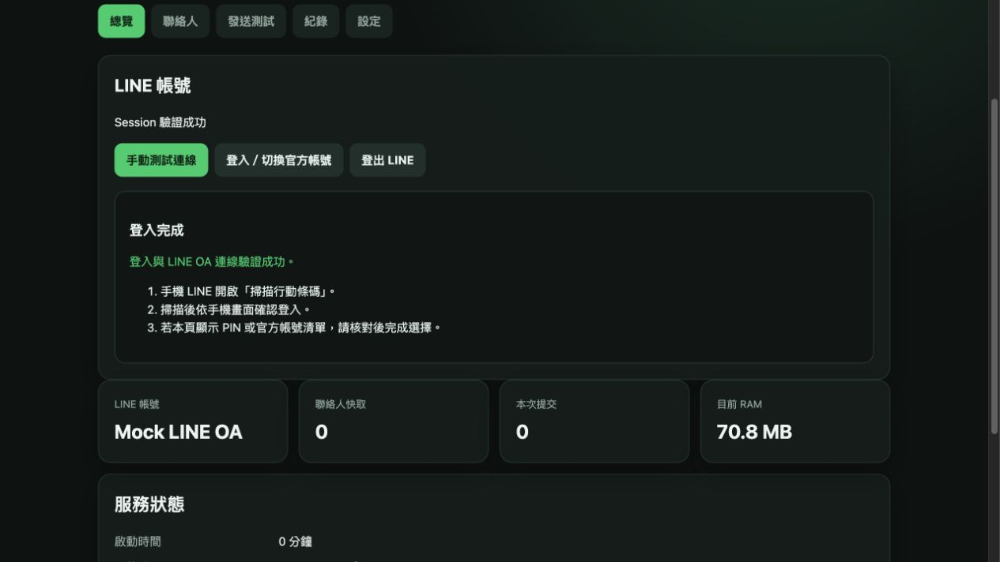

<p align="center"></p>

# LINE OA — Home Assistant Add-on

> ⚠️ **非官方使用警語**
>
> 本專案採非官方方式使用 LINE 服務，使用風險由使用者自行承擔。若因此造成帳號異常、限制、停權或其他損失，開發者不負相關責任。

透過 LINE 官方帳號傳送 Home Assistant 文字、圖片與攝影機快照通知。使用 Home Assistant 的 Web UI 完成 LINE 登入，為收件者設定別名，搭配 [LINE OA HACS 整合](https://github.com/xangin/line-oa-hacs)完成通知。

[](https://github.com/xangin/line-oa-ha-addon/actions/workflows/test.yaml)
[](https://github.com/xangin/line-oa-ha-addon/releases)

> **使用本 Add-on 必須搭配 [LINE OA HACS 整合](https://github.com/xangin/line-oa-hacs)。**

## 功能與需求

- LINE QR Code／PIN 登入、官方帳號選擇及登出。
- 聯絡人查詢、重新整理與收件者別名白名單；已載入的聯絡人於重啟後保留。
- 文字、單張 JPEG／PNG 圖片（最大 10 MiB）及供整合呼叫的 HTTP API v1。
- 文字與圖片共用發送佇列，按進入佇列的順序逐筆處理；取消 Add-on 本地每分鐘發送上限。
- Home Assistant Ingress 管理介面、自動探索與一次性配對交換。
- 當地時區日誌、獨立自動登入紀錄、失敗回應詳情與憑證遮蔽。
- 預建映像安裝；備份保存設定與登入資料，還原時重新下載映像，排除圖片暫存、大型可重建快取與一般日誌。

| 需求 | 說明 |
| --- | --- |
| Home Assistant | 有 Supervisor／App Store 的安裝；一般建議 Home Assistant OS |
| 架構 | **amd64（x86-64）及 aarch64（ARM64）**；Raspberry Pi 需安裝 64 位元 HAOS，32 位元 ARM 不支援 |
| LINE | 手機 LINE，以及可登入、管理該官方帳號的 LINE 帳號 |
| 網路 | HA 可連線 LINE、GitHub 與 GHCR；還原映像也需要網路 |
| 必要整合 | **[LINE OA HACS 整合](https://github.com/xangin/line-oa-hacs)** |

僅有 Home Assistant Container／Core、沒有 Supervisor 的環境不能安裝本 Add-on。也不需要為本 Add-on 另外建立 Messaging API Channel、Channel Access Token 或公開 Webhook URL。



## 1. 申請 LINE 官方帳號

已有官方帳號且能在管理後台進行聊天，可直接進到下一節。

1. 從 LINE 的[免費開設官方帳號](https://tw.linebiz.com/account/)頁面開始，依官方畫面登入並建立帳號。
2. 建立完成後，登入 [LINE Official Account Manager](https://manager.line.biz/)，確認可以選到要使用的官方帳號。
3. 若帳號由其他人建立，請由擁有者透過官方的[權限管理說明](https://tw.linebiz.com/manual/line-official-account/oa-manager/)授予適當管理權限。

申請欄位、驗證、方案及費用以 LINE 官方頁面為準。本專案不代辦申請，也不要求提供 LINE 密碼或手機驗證碼。

## 2. 必須啟用「聊天」並建立對話

**只建立官方帳號還不夠，請先開啟聊天。**

1. 在 [LINE Official Account Manager](https://manager.line.biz/) 選擇官方帳號。
2. 進入「設定 → 回應設定」，啟用「聊天」。若設有回應時間，也請核對手動聊天的時段與回應方式。
3. 用要接收通知的個人 LINE 加入該官方帳號好友，並先傳一則訊息給官方帳號。
4. 回到官方後台的聊天頁面，確認可以找到此對話並手動回覆。

詳細畫面請直接參考 LINE 官方教學：

- [一對一聊天：啟用聊天模式與基本操作](https://tw.linebiz.com/manual/line-official-account/oa-manager-chatting/)
- [回應設定、回應時間與帳號權限](https://tw.linebiz.com/manual/line-official-account/oa-manager/)

聯絡人來自後台聊天集合，**不等於全部好友名單**。找不到收件者時，先確認對方已傳訊、未封鎖帳號，且官方後台可正常聊天；再到 Add-on 重新整理。群組支援取決於 LINE 官方帳號設定及後台實際回傳的聊天對象，不保證每個群組都會出現。

## 3. 安裝 Add-on

[](https://my.home-assistant.io/redirect/supervisor_add_addon_repository/?repository_url=https%3A%2F%2Fgithub.com%2Fxangin%2Fline-oa-ha-addon)

或手動加入：

1. 在 Home Assistant 開啟「設定 → 應用程式／附加元件 → 商店」。介面名稱會隨 HA 版本不同。
2. 右上角選單 →「儲存庫／Repositories」，加入：

   ```text
   https://github.com/xangin/line-oa-ha-addon
   ```

3. 找到 **LINE OA**，按「安裝」。此步驟會下載與版本相符的預建映像。
4. 啟動後按「開啟 Web UI」。建議開啟「開機啟動」。

不需要新增 HA YAML、手動開放 TCP 埠或關閉保護模式。Web UI 必須由 Home Assistant 的「開啟 Web UI」進入，不能直接使用主機 IP 加上內部埠號。

## 4. 登入 LINE 與設定收件者

1. 「總覽」→「登入／切換官方帳號」。
2. 用手機 LINE 掃描行動條碼，依畫面確認登入。若顯示 PIN，請依手機畫面核對；若顯示帳號選擇，選取正確的官方帳號。
3. 等待完成，再按「手動測試連線」，確認狀態為 **CONNECTED**。
4. 「聯絡人」→ **先按「重新整理」**，從 LINE 載入對象；需要時輸入名稱搜尋。
5. 找到對象後按「設為別名」，輸入例如 `home`。別名限 1–32 字元的小寫英文字母、數字、底線或連字號。
6. 確認出現在「允許的收件者別名」。**沒有別名的對象不能發送通知。** 名稱相同時請核對 Web Chat ID。
7. 到「發送測試」選取別名，先對已確認的收件者發送少量測試訊息。

`who` 使用 `home` 這類別名，不填 LINE ID、電話號碼或 Messaging API User ID。

「登出 LINE」清除此 Add-on 保存的登入資料與聯絡人快取，保留別名與 HA 配對；之後需重新登入。切換官方帳號後，請重新核對收件者與別名。

已載入的聯絡人會保存到 Add-on 私有資料目錄；重啟後開啟「聯絡人」即可查看，不必再次向 LINE 查詢。首次安裝或從未保存聯絡人的舊版升級後，仍需按一次「重新整理」。聯絡人依官方帳號區分，切換帳號不會套用上一個帳號的快取；登出會清除快取。最多保留 10,000 筆已查詢對象。

### 檢查間隔與紀錄

- 「設定 → 登入狀態檢查」以**分鐘**設定，儲存後立即生效並重新計時，不需重啟。可設 0～10080 分鐘；舊版設定升級時預設為 **45 分鐘**。
- 設為 **0**：停用啟動與定時檢查，發送遇到登入失效時才嘗試自動恢復；「手動測試連線」仍可使用，但不會因此自動登入。重啟後，已載入的 Session 會先顯示待驗證，直到發送成功或手動測試確認狀態。讀取狀態本身不會觸發登入。
- 大於 0：啟動時確認連線，之後只在發送閒置達設定時間時檢查；再次發送會重新計時，發送中的工作會優先處理。
- 「紀錄 → 自動登入紀錄」列出實際恢復的開始／結束時間、來源、結果與錯誤代碼，可與 LINE 登入通知對照。時間依 HA 時區顯示，最近 **200 筆**於重啟後仍保留。正常檢查未觸發登入時不新增；更新前的歷史無法回補。
- 自動恢復若仍要求手機確認，請在「總覽」重新登入。結果不明的訊息不會自動重送；詳細錯誤仍可從「一般紀錄」查看。


## 5. 必須搭配 LINE OA HACS 整合

**本 Add-on 必須搭配 [LINE OA HACS 整合](https://github.com/xangin/line-oa-hacs)使用。**

HACS 安裝、配對、Home Assistant Actions 與自動化使用方式，請直接參閱 **[HACS repo 的完整說明](https://github.com/xangin/line-oa-hacs#readme)**。

## ARM64／Raspberry Pi

從 **0.1.5** 起，商店提供 amd64 與 aarch64，使用同一個 GHCR 版本；Docker 會依主機選擇對應映像。Raspberry Pi 請使用 **64 位元的 Home Assistant OS**，不能以 32 位元 ARM 系統安裝 aarch64 映像。

發布前會在 amd64 與 ARM64 原生 Linux runner 分別執行測試與容器 smoke，再組合多架構映像。ARM64 另以 Apple Silicon Mac 的 ARM64 Linux VM 驗證；此項測試不等於已在實體 Raspberry Pi 的 HAOS 做安裝測試。[架構與驗證範圍](docs/architectures.md)。

## 備份、還原與更新

- 在 Home Assistant 系統備份中包含 **LINE OA**。備份保存登入 Session、別名、聯絡人清單、自動登入紀錄、永久身份、配對憑證雜湊及 App 設定。
- 正式版使用 GHCR 預建映像，Supervisor 不必把整份 runtime／Docker 映像放進 App 備份；還原時下載備份對應的版本。
- 暫存圖片、可重建的快取目錄及一般日誌排除；有筆數上限的聯絡人清單與自動登入紀錄保留。實際備份大小仍受必要資料與 HA 備份封裝影響。
- 冷備份會短暫停止並恢復 Add-on。備份本身含敏感登入資料，請保護 HA 備份與復原金鑰。
- 從商店更新會保留 `/data`；**不要以解除安裝後重裝代替更新**。
- 還原需要可連線 GHCR，且該版本映像仍存在。即使檔案成功還原，LINE 仍可能要求重新登入。

實機的小型設定備份由約 **86.55 MiB 降為 10 KiB**；實際大小隨必要資料量不同。[備份內容與實測](docs/backups.md)。

## 常見問題

| 情況 | 先檢查 |
| --- | --- |
| 商店看不到 Add-on | 確認已加入本儲存庫、重新整理商店，且主機為 amd64 或 aarch64 |
| 安裝／還原下載失敗 | 確認 HA 可連線 `ghcr.io` 及 GitHub，查看 App／Supervisor 日誌 |
| 無法登入／沒有帳號可選 | 確認手機使用的 LINE 帳號具有官方帳號管理權限，且官方網站可正常登入 |
| 找不到聯絡人 | 啟用聊天、讓對方先傳訊，在官方後台確認對話，再按 Add-on「重新整理」 |
| `TARGET_NOT_ALLOWED` | 收件者尚未設定允許別名，或 `who` 拼寫不同 |
| `WEB_UI_CSRF_TOKEN_*` | 頁面驗證已失效；重新整理 Add-on 頁面再操作，遭拒的操作尚未執行 |
| `LINE_HTTP_403_CSRF_OR_PERMISSION_DENIED` | 展開失敗紀錄，檢查 LINE 回應與帳號權限，必要時重新登入 |
| `LOGIN_BUSINESS_CSRF_MISSING` | LINE 登入頁與預期格式不同；查看遮蔽後的回應，提供版本與錯誤名稱回報 |
| Home Assistant 整合或 Actions 問題 | 請參閱 [HACS repo 的說明](https://github.com/xangin/line-oa-hacs#readme) |
| `UNKNOWN` | 不自動重送，先確認 LINE 是否已收到 |
| 排隊逾時／佇列已滿 | 訊息尚未送出；稍後重新呼叫。等待中的請求斷線或服務停止時會取消，不會延後補發 |

日誌依 HA 提供的當地時區顯示；「紀錄」可以展開失敗系統回應。憑證會遮蔽，但內容仍可能包含帳號或對象資訊，公開回報前請自行檢查。

發送佇列保存在記憶體，同時最多保留 32 筆（含正在執行的訊息），內容合計最多 20 MiB；等待超過 10 秒會明確回報尚未發送，避免超過現有 HACS 請求等待時間。輪到發送時會重新核對收件者別名與登入帳號。已開始處理的訊息若回應遺失，仍可能已送達，維持 `UNKNOWN` 不自動重送。LINE 本身的限制照常回報。

[故障排除](docs/troubleshooting.md) · [回報問題](https://github.com/xangin/line-oa-ha-addon/issues/new/choose) · [安全回報](SECURITY.md)

## 開發與介接

執行環境為 Node.js 24，正式 runtime 無第三方 npm 生產相依或 Chromium。原有 LINE 通訊核心由 Gateway 0.5.0 移植，保留一次提交、結果不明不重送的行為。

```sh
npm --prefix line_oa/app ci --ignore-scripts --no-audit --no-fund
npm --prefix line_oa/app test
python3 scripts/check-backup-policy.py
python3 scripts/build-local-image.py
python3 scripts/container-smoke.py
```

[完整操作](DOCS.md) · [安裝](docs/installation.md) · [API 相容性](docs/api-compatibility.md) · [安全配對](docs/secure-pairing.md) · [探索](docs/discovery.md) · [安全邊界](docs/security.md) · [測試範圍](docs/verification.md) · [原始碼來源](docs/source-audit.md) · [貢獻指南](CONTRIBUTING.md)

## 授權與商標

專案程式碼採 [MIT License](LICENSE)。Node.js、Debian 及建置工具各依其原有授權；LINE、Home Assistant 及相關商標屬其各自權利人。本專案圖示為社群專案識別，不代表官方合作。
